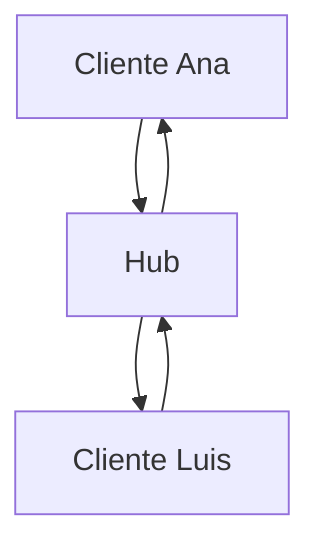

# 00. Diccionario completo del proyecto

Este documento explica las piezas antes de usarlas. Si una palabra aparece más adelante, vuelve aquí.

## API

Una API es un contrato para que un programa pueda pedirle algo a otro programa. Nuestra API recibe peticiones HTTP y devuelve JSON.

```text
curl / navegador / aplicación móvil
              ↓
          API Go
              ↓
       PostgreSQL o WebSocket
```

## Recurso

Un recurso es una entidad del sistema. En esta aplicación los recursos son `users`, `posts`, `rooms` y `messages`. Una ruta representa una colección o un elemento de esa colección.

```text
/users       colección de usuarios
/users/1     usuario con ID 1
/rooms/1     sala con ID 1
```

## REST

REST usa URLs para recursos y métodos HTTP para operaciones. `GET` consulta, `POST` crea, `PATCH` modifica y `DELETE` elimina o desactiva.

REST no mantiene la conversación abierta: cada request tiene su response.

## HTTP

Una request tiene método, URL, headers y body. Una response tiene status, headers y body.

```http
POST /users HTTP/1.1
Content-Type: application/json

{"username":"ana"}
```

Los status codes no son decoración: forman parte del contrato. `201` significa que algo fue creado; `404` significa que no existe; `403` significa que existe pero no tienes permiso.

## JSON

JSON es texto estructurado. Go lo convierte a structs mediante `json.Decoder` y convierte structs a JSON mediante `json.Encoder`.

```go
type UserRequest struct {
    Username string `json:"username"`
}
```

La etiqueta `json:"username"` conecta el campo Go con la propiedad JSON.

## Router

El router decide qué función debe ejecutarse según el método y la URL.

```go
router.Post("/users", store.createUser)
```

Esto significa: una request `POST /users` termina en `createUser`.

## Handler o endpoint

El handler es la frontera HTTP. Lee headers y JSON, llama a la lógica de aplicación y decide el status code.

El handler no debería contener todo el SQL ni toda la lógica de negocio.

## Store

`Store` es la implementación actual que coordina validaciones y consultas SQL. Es una simplificación didáctica. En una arquitectura más grande se separaría en endpoint, service y repository.

## PostgreSQL

PostgreSQL es la base de datos que conserva información después de cerrar la API. La memoria del programa desaparece al apagarlo; la base de datos conserva usuarios, salas y mensajes.

## SQL parametrizado

Los parámetros separan la consulta de sus valores:

```go
db.QueryRowContext(ctx, "SELECT id FROM users WHERE username=$1", username)
```

No se debe concatenar texto externo dentro del SQL porque puede provocar inyección SQL.

## Migración

Una migración es un cambio versionado del esquema. `001_init.sql` crea las tablas iniciales y una migración posterior añade cambios sin borrar el historial.

## Autenticación

Autenticación responde “¿quién eres?”. En este proyecto el usuario inicia sesión con username y password. La password se guarda como hash bcrypt, no como texto plano.

## Autorización

Autorización responde “¿puedes hacer esto?”. Un usuario autenticado puede no tener permiso para una sala. Por eso primero se valida la identidad y después la membresía.

## JWT

Un JWT es un token firmado. El servidor puede verificar que no fue modificado y leer el `sub`, que representa el ID del usuario. La firma no cifra los datos; solo permite comprobar su autenticidad.

```http
Authorization: Bearer <token>
```

## WebSocket

WebSocket es una conexión persistente. HTTP sigue el patrón “pido y respondes”; WebSocket permite que cliente y servidor envíen eventos mientras la conexión permanece abierta.

```text
HTTP:      request → response → fin
WebSocket: handshake → mensajes → mensajes → cierre
```

## Hub

El hub es el coordinador central de clientes conectados. No es la sala ni la base de datos: es la estructura en memoria que sabe qué conexiones están activas en cada sala.



Cuando Ana envía un mensaje, el hub no debería inventarlo ni guardarlo directamente. El flujo correcto es:

```text
leer evento
→ validar usuario y sala
→ guardar en PostgreSQL
→ publicar evento
→ hub envía a clientes de la sala
```

## Cliente WebSocket

Cada cliente representa una conexión abierta. Tiene una conexión, un `roomID`, un usuario y un canal de salida.

## Goroutine

Una goroutine es una función ejecutándose concurrentemente. El chat usa una para leer y otra para escribir:

```go
go client.writeLoop(ctx)
client.readLoop(ctx)
```

Leer y escribir por separado evita que una operación lenta bloquee toda la conexión.

## Canal

Un canal comunica goroutines de forma segura. El hub entrega eventos al canal `send`; la goroutine de escritura los extrae y los manda al cliente.

```go
client.send <- event
event := <-client.send
```

## Mutex

Varias conexiones pueden registrarse o salir al mismo tiempo. El mutex protege el mapa de salas para que dos goroutines no lo modifiquen simultáneamente.

## Context

El contexto transmite cancelación y deadlines. Cuando el cliente se desconecta, las goroutines deben dejar de trabajar y liberar recursos.

## Broadcast

Broadcast significa difundir un evento a todos los clientes de una sala. No significa enviarlo a todos los usuarios del sistema.

## Persistencia

Persistir es guardar un dato en PostgreSQL. Un evento enviado por WebSocket solo se considera mensaje válido después de guardarse correctamente.

## Rate limiting

Rate limiting limita cuántas requests puede realizar una IP en una ventana de tiempo. Sirve para reducir abusos y errores accidentales, pero no reemplaza autenticación ni una protección distribuida.

## Test

Un test es una comprobación automática. Un test unitario comprueba una pieza aislada; uno de integración comprueba varias piezas reales, como Go y PostgreSQL.

## Reto final

Explica con tus palabras el recorrido de un mensaje:

```text
cliente
→ WebSocket
→ readLoop
→ autorización
→ PostgreSQL
→ hub
→ canal send
→ writeLoop
→ otros clientes
```
