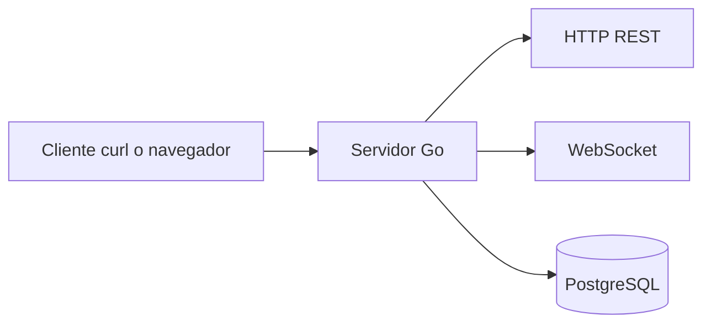

# 00. Antes de comenzar

## Qué vamos a construir

Construiremos una pequeña comunidad gamer. Un usuario podrá publicar algo, crear una sala y conversar con otras personas en tiempo real.

La primera versión es deliberadamente pequeña. Incluye login con JWT, publicaciones, relaciones, salas y chat en tiempo real; cada pieza se introduce cuando ya entiendes la anterior.

## Qué necesitas saber

No necesitas conocer todo Go. Durante el curso aprenderás lo necesario:

| Concepto | Para qué aparece |
|---|---|
| Variable y función | Leer cualquier archivo Go |
| Struct | Representar usuarios y mensajes |
| Error | Informar fallos sin excepciones ocultas |
| Context | Cancelar operaciones y conexiones |
| SQL | Guardar y consultar datos |
| Goroutine | Atender trabajo concurrente |
| Canal | Comunicar goroutines |

## Mapa de la aplicación



## Cómo estudiar

En cada capítulo realiza este ciclo:

1. Lee los [conceptos fundamentales](01-conceptos.md).
2. Ejecuta el comando.
3. Mira la respuesta completa.
4. Abre el archivo indicado.
5. Cambia una sola cosa.
6. Ejecuta de nuevo.
7. Resuelve el reto.

## Decisión educativa: identidad verificada

Las acciones que modifican datos y el WebSocket requieren un JWT. El middleware valida el token y coloca el ID en el contexto; los handlers no confían en un ID enviado por el cliente.

```http
Authorization: Bearer <token>
```

## Checkpoint

<details>
<summary>¿Por qué no empezamos con autenticación?</summary>

Porque primero necesitamos entender HTTP y SQL; después la autenticación muestra cómo proteger ese mismo flujo.
</details>

## Reto

Dibuja en una hoja qué ocurre cuando alguien envía un mensaje. Incluye cliente, servidor, sala, base de datos y otro cliente.
