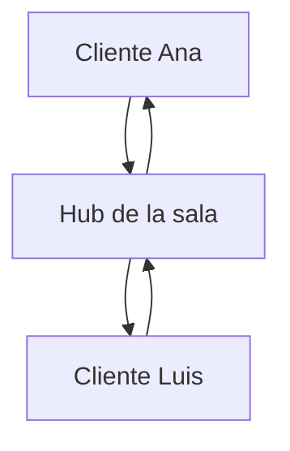

# 01. Conceptos: API REST, HTTP y WebSocket

## API

Una API es una puerta de entrada para que otro programa use nuestra aplicación. Un cliente envía una petición y recibe una respuesta.

```text
Cliente → petición → API → respuesta → Cliente
```

En este proyecto, `curl`, un navegador o una aplicación móvil son clientes.

## REST

REST organiza la API usando recursos y métodos HTTP.

| Método | Acción | Ejemplo |
|---|---|---|
| `GET` | Leer | `GET /users` |
| `POST` | Crear | `POST /users` |
| `PATCH` | Modificar | `PATCH /users/1` |
| `DELETE` | Eliminar o desactivar | `DELETE /posts/1` |

Ejemplo de creación:

```http
POST /users
Content-Type: application/json
```

```json
{"username":"pixel_ana","display_name":"Ana"}
```

El servidor responde con `201 Created` porque se creó un recurso. `200` significa éxito, `400` petición inválida, `403` prohibido, `404` inexistente y `409` conflicto.

## JSON

JSON es el formato de texto que transporta datos. `json.Decoder` convierte el body en un struct Go y `json.Encoder` convierte un valor Go en respuesta.

```json
{"content":"Hola comunidad"}
```

## WebSocket

REST termina después de cada respuesta:

```text
cliente pide → servidor responde → conexión termina
```

WebSocket mantiene la conexión abierta:

```text
cliente conecta → ambos envían eventos → conexión permanece abierta
```

REST sirve para crear usuarios o consultar historial. WebSocket sirve para que un mensaje llegue inmediatamente al resto de la sala.

## Hub

El hub coordina las conexiones activas de una sala.



Cuando Ana envía un mensaje, el hub lo recibe y lo coloca en el canal de salida de los clientes de esa sala.

## Goroutine, canal y context

Una goroutine permite leer y escribir de forma concurrente:

```go
go client.writeLoop(ctx)
client.readLoop(ctx)
```

El canal es la tubería entre el hub y la goroutine que escribe:

```go
client.send <- event
event := <-client.send
```

El `context.Context` avisa cuándo una conexión terminó y permite detener sus goroutines.

## Checkpoint

<details><summary>¿REST o WebSocket?</summary>
REST para crear usuarios, publicar y consultar historial. WebSocket para mensajes y eventos en tiempo real.
</details>

## Reto

Clasifica estas acciones: crear usuario, cargar posts, enviar mensaje en tiempo real, consultar mensajes antiguos y avisar que alguien entró a una sala.
