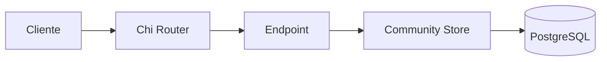

# 03. Arquitectura

## Qué vas a aprender

Vas a seguir una petición desde el JSON que escribe el cliente hasta el SQL que ejecuta PostgreSQL.



Prueba:

```bash
curl -i -X POST http://localhost:3000/users \
  -H 'Content-Type: application/json' \
  -d '{"username":"pixel_ana","display_name":"Ana"}'
```

El recorrido es: JSON → handler → validación → SQL parametrizado → PostgreSQL → JSON.

## Paso a paso en el código

### 1. Arranque

`cmd/api/main.go` crea la conexión y llama a `database.Migrate`. Después crea un `community.Store` con el pool SQL.

### 2. Registro de rutas

`community.Routes` relaciona una URL con un handler:

```go
r.Post("/users", store.createUser)
```

Esto significa: cuando llega un `POST /users`, ejecuta `createUser`.

### 3. Decodificar JSON

```go
var req userRequest
if err := decode(r, &req); err != nil {
    fail(w, err)
    return
}
```

`req` empieza vacío. `decode` lee el body y rellena sus campos según las etiquetas JSON.

### 4. Validar y guardar

```go
if strings.TrimSpace(req.Username) == "" {
    return User{}, errors.New("username y display_name son obligatorios")
}
```

Después el repositorio ejecuta SQL parametrizado. `$1`, `$2` y `$3` son lugares reservados; sus valores se envían separados.

### 5. Responder

`write` establece `Content-Type`, escribe el status HTTP y codifica el resultado con `json.NewEncoder`.

## Por qué no concatenamos SQL

Esto sería peligroso:

```go
query := "SELECT * FROM users WHERE username = '" + username + "'"
```

El valor podría cambiar la consulta completa. Los parámetros separan instrucciones y datos.

## Checkpoint

<details><summary>¿Dónde pondrías una regla como “el username no puede estar vacío”?</summary>

Antes del INSERT, en la lógica de aplicación. Así el usuario recibe un error claro y no dependemos de que PostgreSQL descubra un problema tarde.
</details>

🎯 **Reto:** encuentra `$1`, `$2` y `$3` en el SQL y explica por qué no se concatenan strings.
