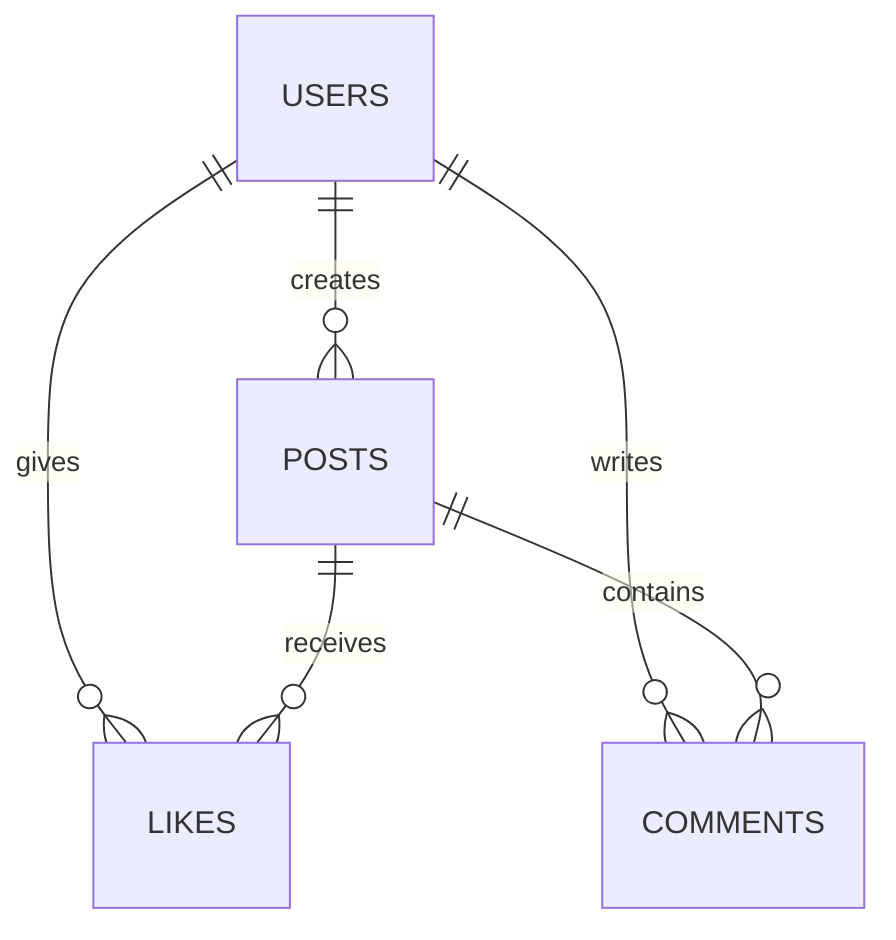

# 05. Red social

## Qué vas a aprender

Crearás contenido asociado al usuario autenticado y observarás cómo una relación many-to-many se convierte en una tabla de likes.

Primero guarda el token obtenido en el capítulo anterior:

```bash
TOKEN='pega-aqui-tu-jwt'
```

```bash
curl -X POST http://localhost:3000/posts \
  -H "Authorization: Bearer $TOKEN" -H 'Content-Type: application/json' \
  -d '{"content":"Mi primera partida ranked"}'
curl http://localhost:3000/posts
curl -X POST http://localhost:3000/posts/1/likes -H "Authorization: Bearer $TOKEN"
```

Los likes usan una clave compuesta para que el mismo usuario no pueda repetirlos.

## Modelo de datos



`likes` tiene `(user_id, post_id)` como clave primaria. Eso significa que la pareja solo puede aparecer una vez.

## Qué ocurre al crear un post

1. El middleware valida el JWT y obtiene el usuario.
2. El handler decodifica `content`.
3. Rechaza texto vacío o demasiado largo.
4. Ejecuta `INSERT INTO posts`.
5. Devuelve el ID generado.

## Error intencional

Repite el like:

```bash
curl -i -X POST http://localhost:3000/posts/1/likes -H 'X-User-ID: 2'
curl -i -X POST http://localhost:3000/posts/1/likes -H 'X-User-ID: 2'
```

La segunda petición devuelve `409 Conflict`: la restricción de la base de datos protege la regla aunque dos peticiones lleguen casi al mismo tiempo.

## Reto

Añade un límite de 500 caracteres a `content`. Decide si la validación debe ejecutarse antes del SQL y explica por qué.

Para leer comentarios usa:

```bash
curl http://localhost:3000/posts/1/comments
```

🎯 **Reto:** añade un comentario y prueba dos veces el mismo like.
