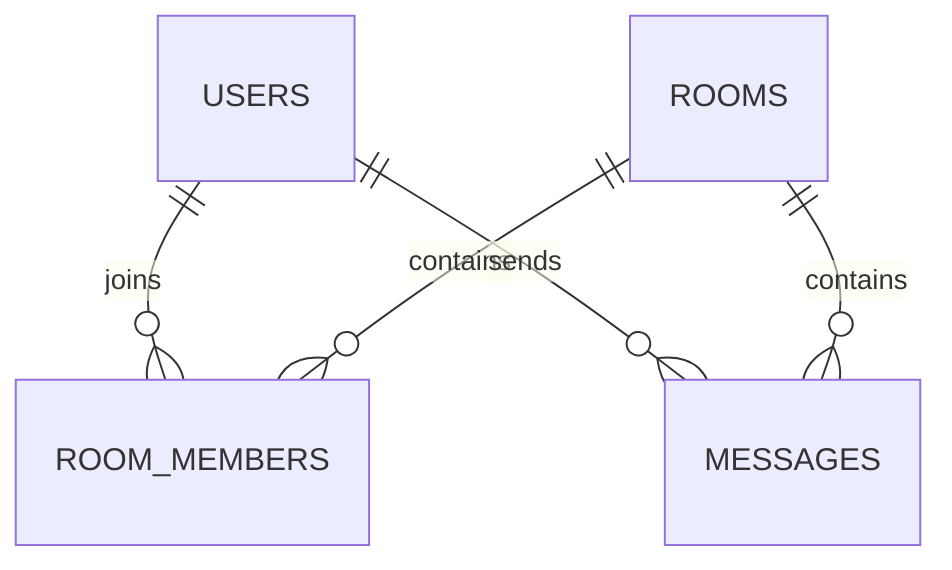

# 06. Salas y mensajes

## Qué vas a aprender

Separarás una sala, sus miembros y el historial de mensajes. Primero persistimos el mensaje con HTTP; después lo emitimos en tiempo real con WebSocket.

```bash
curl -X POST http://localhost:3000/rooms \
  -H 'Content-Type: application/json' \
  -d '{"name":"RPG nocturno"}'
curl -X POST http://localhost:3000/rooms/1/join -H "Authorization: Bearer $TOKEN"
curl -X POST http://localhost:3000/rooms/1/messages \
  -H 'Content-Type: application/json' \
  -d '{"user_id":1,"content":"¿Jugamos?"}'
curl http://localhost:3000/rooms/1/messages
```

El mensaje se guarda en PostgreSQL para que el historial sobreviva a una desconexión.

## Unirse a una sala

Antes de usar el chat, el usuario debe pertenecer a la sala:

```bash
curl -i -X POST http://localhost:3000/rooms/1/join \
  -H 'X-User-ID: 1'
curl http://localhost:3000/rooms/1/members
```

Para salir:

```bash
curl -i -X DELETE http://localhost:3000/rooms/1/join \
  -H 'X-User-ID: 1'
```

El servidor no permite enviar mensajes WebSocket a usuarios que no estén en `room_members`.

## Modelo de datos



La ruta HTTP valida IDs y guarda el mensaje. La conexión WebSocket también exige pertenencia antes de aceptar el handshake.

## Qué valida el servicio

`user_id` debe ser positivo y `content` no puede estar vacío. La foreign key de PostgreSQL comprueba que existan la sala y el usuario.

## Reto guiado

Prueba un mensaje de más de 500 caracteres y observa el `400`. Después intenta enviar sin hacer `join` y observa el `403`.
