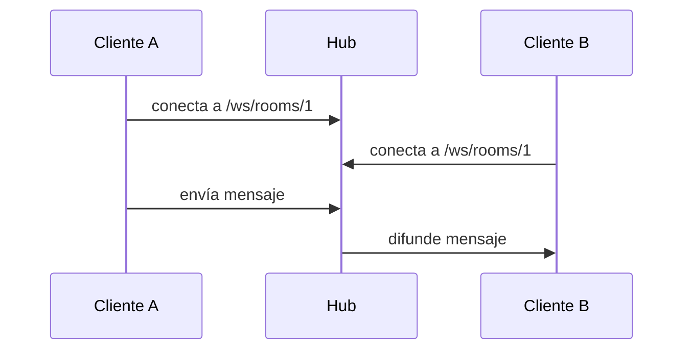
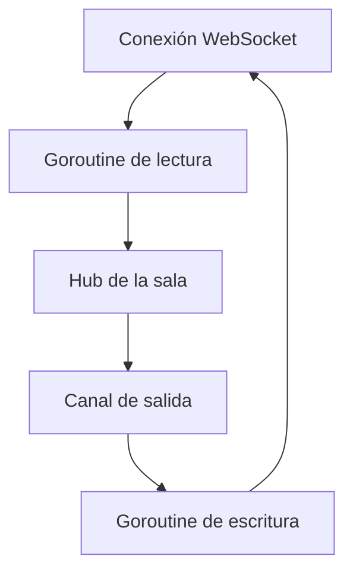

# 07. WebSocket, goroutines y canales

Antes de continuar, lee [el diccionario completo](00-conceptos-completos.md), especialmente las secciones **Hub**, **Goroutine**, **Canal**, **Context** y **Broadcast**.

## Qué vas a aprender

Entenderás por qué el chat necesita una conexión persistente y cómo el hub coordina varios clientes.

HTTP responde una petición; WebSocket mantiene una conexión abierta.



El hub usa `github.com/coder/websocket`, una goroutine para leer, otra para escribir y un canal de salida por cliente.

## Qué hace exactamente el hub

El hub mantiene un mapa en memoria parecido a este:

```text
rooms = {
  "1": { cliente-A, cliente-B },
  "2": { cliente-C }
}
```

Cuando llega un evento de la sala `1`, solo se recorren `cliente-A` y `cliente-B`. El hub no consulta todos los usuarios de PostgreSQL para cada mensaje; usa las conexiones activas que conoce en memoria.

El hub tiene cuatro responsabilidades:

1. Registrar clientes nuevos.
2. Eliminar clientes desconectados.
3. Mantener separadas las salas.
4. Difundir eventos mediante los canales de salida.

El hub no debería encargarse de passwords, SQL de usuarios ni reglas de negocio. Es un coordinador de conexiones.

## Persistencia y autorización

El cliente debe conectarse enviando `Authorization: Bearer <token>`. Antes de aceptar la conexión, el servidor valida el JWT y comprueba que el usuario pertenece a la sala. Cada evento válido se guarda en `messages` antes de difundirse.

Si el guardado falla, el cliente recibe un evento `error` y no se publica un mensaje perdido.

## Probar con dos clientes

Con `websocat`, abre dos terminales después de unir sus usuarios a la sala:

```bash
websocat -H="Authorization: Bearer $TOKEN" ws://localhost:3000/ws/rooms/1
```

Envía JSON desde una terminal:

```json
{"content":"¿Jugamos una partida?"}
```

Ambas conexiones deben recibir el evento.

Al conectar y desconectar también se publican eventos de presencia:

```json
{"type":"user_joined","room_id":"1","user_id":"2"}
{"type":"user_left","room_id":"1","user_id":"2"}
```

## Dos direcciones simultáneas



Una sola conexión necesita lectura y escritura independientes. El canal evita que varias partes escriban simultáneamente en el mismo socket.

## Código importante

```go
go client.writeLoop(r.Context())
client.readLoop(r.Context())
```

La lectura queda en la goroutine actual. La escritura ocurre en paralelo. Cuando `Read` falla porque el cliente se desconecta, se elimina del hub.

```go
select {
case event := <-client.send:
    wsjson.Write(ctx, conn, event)
case <-ctx.Done():
    return
}
```

El `select` espera un evento o la cancelación del contexto.

## Reto

Añade un contador de clientes conectados por sala y muéstralo en un evento `presence`.
